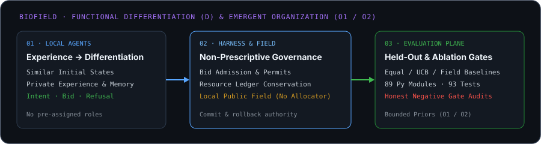

<p align="right">
  <strong>English</strong> · <a href="./README_ZH.md">简体中文</a>
</p>

# Biofield — Multi-Agent Differentiation & Emergent Organization Harness

An experimental multi-agent systems & evaluation harness (`89` Python modules under `src/`, `93` pytest suites, `30` empirical result reports) investigating a core research question:

> **Under a governed harness that retains fact, safety, resource, admission, and commit authority, can similarly initialized agents develop causal functional differentiation (`D`) from local experience, self-organize into net-positive task topologies (`O1`), and retain bounded, revocable organizational priors across tasks (`O2`) without a central role allocator?**

<p align="center">
  <picture>
    <source media="(prefers-color-scheme: dark)" srcset="./assets/biofield-arch-dark.svg" />
    <source media="(prefers-color-scheme: light)" srcset="./assets/biofield-arch-light.svg" />
    
  </picture>
</p>

---

## Architecture & Four Invariants

1. **Local Differentiation (`D`)**: Agents start from near-identical capabilities; behavioral specialization emerges from private experience and residual state rather than hardcoded role prompts or menu positions.
2. **In-Task Self-Organization (`O1`)**: Agents emit `Intent`, `Bid`, `Refusal`, and `Communication` proposals; the Field exposes non-prescriptive local public conditions while the Harness enforces bid admission, communication permits, and exact resource conservation.
3. **Independent Evaluation Plane**: Measurement (`MEAS0` / `LA0–LA1` / `E0`) is strictly separated from the runtime harness — featuring `Equal / UCB / Field` baselines, deterministic `f0.native.v2` replay from hashed evidence, and `2×2` menu-vs-schema LLM ablations (`qwen3:8b`).
4. **Honest Negative-Result Discipline**: Experimental reports explicitly publish unclosed readiness requirements and failed ablations (for example, `Gate M` remains `FAIL` pending full production closure rather than over-claiming synthetic benchmarks).

---

## Documentation & Verification

- [Core Research Thesis](docs/research/BIOFIELD_CORE_RESEARCH_THESIS.md)
- [Final Architecture Spec](docs/architecture/ARCHITECTURE_EXPLORATION_FINAL.md)
- [Experiment Protocol](docs/experiments/EXPERIMENT_PROTOCOL.md)
- [Current Implementation Status](docs/STATUS.md)
- [30 Empirical Result Audits](results/)

```bash
python -m venv .venv
.venv/bin/python -m pip install '.[dev]'
.venv/bin/python -m pytest -q
```
