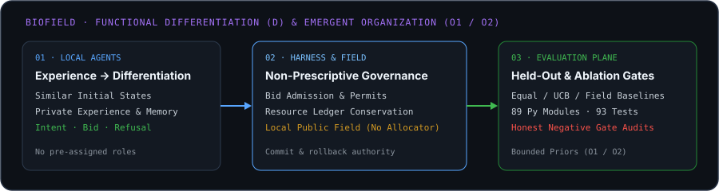

<p align="right">
  <a href="./README.md">English</a> · <strong>简体中文</strong>
</p>

# Biofield — 多 Agent 功能分化与自组织评测研究底座

一个独立的多 Agent 系统架构与测量评测研究工程（`89` 个 `src/` Python 模块、`93` 套 `pytest` 测试、`30` 份实证实验报告），围绕一个核心命题展开：

> **在 Harness 保留事实、安全、资源守恒、准入与最终提交权的条件下，相近初态的 Agent 能否脱离中央分配器，仅凭局部经验产生可因果验证的功能分化（`D`），在任务内自发形成有净收益的局部组织（`O1`），并在有限容量与可撤销选择压力下沉淀出跨任务组织先验（`O2`）？**

<p align="center">
  <picture>
    <source media="(prefers-color-scheme: dark)" srcset="./assets/biofield-arch-dark.svg" />
    <source media="(prefers-color-scheme: light)" srcset="./assets/biofield-arch-light.svg" />
    
  </picture>
</p>

---

## 核心架构与四项不变量

1. **局部分化（`D`）**：Agent 从相近初态出发，由不同局部经历与私有残差状态驱动能力分化，而非依赖预设角色 ID、提示词固定分工或中央调度器。
2. **任务内自组织（`O1`）**：Agent 自主产生 `Intent`、`Bid`、`Refusal` 与通信提案；`Field` 只提供非处方性的局部公共条件，`Harness` 统一掌控竞价准入、通信许可、资源账本守恒与回滚权威。
3. **独立评测平面（Evaluation Plane）**：测量系统（`MEAS0` / `LA0–LA1` / `E0`）与运行时严格解耦，内置 `Equal / UCB / Field` 对照基线、基于 Evidence Hash 重算的确定性 `f0.native.v2` 回放，以及本地模型 `qwen3:8b` 的 `2×2` 菜单/Schema 消融探针。
4. **负向结果诚实纪律**：对未闭环的就绪度指标与消融失败结论如实记录（例如 `Gate M` 在全链路生产闭环前显式维持 `FAIL`），不把离线合成基线包装成生产能力。

---

## 核心文档与运行测试

- [核心研究命题](docs/research/BIOFIELD_CORE_RESEARCH_THESIS.md)
- [当前架构规格](docs/architecture/ARCHITECTURE_EXPLORATION_FINAL.md)
- [实验执行协议](docs/experiments/EXPERIMENT_PROTOCOL.md)
- [实现与证据状态](docs/STATUS.md)
- [30 份实证实验与审计报告](results/)

```bash
python -m venv .venv
.venv/bin/python -m pip install '.[dev]'
.venv/bin/python -m pytest -q
```
