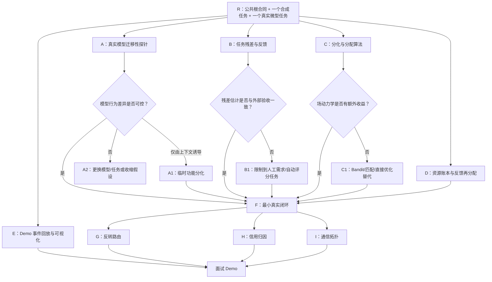

# 自组织 Agent 能量场架构：并行工程探索规格 v0.5

## 0. 文档定位

本文是一份面试前可执行的研究计划，不是生产架构承诺。

它保留以下核心构想：

1. Agent 从相近状态出发，根据任务、执行历史和反馈形成临时分工；
2. 计算、时间、通信和验证都属于有限资源；
3. 任务路由负责初始资源注入，任务反馈负责后续资源重分配；
4. 任务表示和任务反馈使用同一任务状态坐标；
5. 分化初期通过反转路由、容量限制和探索补贴避免赢家锁定；
6. 有效的证据、转换和通信路径可以形成可撤销的组织先验；
7. 场动力学、latent communication 和异构对齐都必须与简单基线比较，失败时允许被替换或删除。

v0.5 的主要变化不是增加机制，而是改变验证顺序：

> 不再先做漫长的无模型阶段，而是先建立极小公共合同，同时并行暴露真实模型、任务反馈、分配算法和能量账本的风险。

当前所有工程探索继续位于独立实验目录，不接入 OpenPilot 主运行时。

---

## 1. 当前核心研究问题

### 1.1 总问题

一个依靠外部目标与真实计算预算维持的 Agent 组织，能否通过可验证反馈，把有限资源持续配置到具有更高边际贡献的 Agent、能力和协作路径上，同时：

- 保持任务覆盖；
- 减少无价值重复；
- 保留必要探索；
- 避免早期赢家锁定；
- 适应需求和环境变化；
- 让资源和贡献变化可追溯。

### 1.2 面试前必须回答的问题

1. 同一个真实模型的多个逻辑 Agent，能否表现出可控制、可测量的功能差异？
2. 任务表示与任务反馈能否共享同一套指标并保持外部有效性？
3. 反馈驱动的资源再分配是否优于固定均分？
4. 场动力学是否比贪心、匹配或 bandit 等简单控制器更有价值？
5. 反转路由是否真的减少马太效应，而不是简单平均分配？
6. 一个最小真实闭环能否在可接受成本下跑通？

### 1.3 面试前不要求回答的问题

- 跨模型 hidden-state 对齐；
- 大规模 `N > 100` 的平均场近似；
- 完整组织记忆和长期热启动；
- 世界范围的统一能量货币；
- 开放任务上的精确信用 Shapley value；
- 与 OpenPilot 生产运行时集成。

---

## 2. 最小架构

```text
External Goal + Resource Budget
              ↓
Task Specification + Residual Estimate
              ↓
Allocator / Router
              ↓
Agent Actions + Tool Effects
              ↓
Artifacts + Evidence + Resource Cost
              ↓
Verifier / Environment Feedback
              ↓
Residual Update + Provisional Credit
              ↓
Budget Reallocation / Continue / Stop
```

连续场只生成分配倾向和优先级。真实资源发放、账本扣减、权限、失败和终止继续由离散控制器执行。

---

## 3. v0.5 的最低数学合同

这些合同必须先成立，但不需要形成一个漫长实验阶段。

### 3.1 任务残差是估计量

开放任务中的真实残差通常不可观测：

\[
D_t^*=\text{真实但未知的任务残差}
\]

系统维护的是：

\[
\hat D_t=ResidualEstimate(G,S_t,E_t)
\]

- \(G\)：目标与约束；
- \(S_t\)：当前已接受状态；
- \(E_t\)：支持、反对和未知证据；
- \(\hat D_t\)：当前可观测残差估计。

合成任务可以直接知道 \(D_t^*\)，真实任务只能比较 \(\hat D_t\) 与外部验收结果的一致性。

系统必须保留 `out_of_ontology` 通道，用来记录无法映射到现有需求维度的证据、风险和用户反馈，避免任务本体自我封闭。

### 3.2 需求坐标具有版本

每一次需求维度新增、删除、拆分或合并都会产生新的：

```text
requirement_schema_version
```

跨版本更新必须提供：

- 旧维度到新维度的映射；
- 历史证据重新评估规则；
- capability/allocation 迁移规则；
- 无法迁移时的重新分化路径。

只有在映射明确时，才能计算跨周期的 \(\Delta\hat D_t\)。

### 3.3 Allocation 位于非负单纯形

Agent 的任务分配不是任意单位向量：

\[
A_{i,k}\ge0,
\qquad
\sum_kA_{i,k}=Capacity_i
\]

动力学更新后必须使用 simplex projection。Agent 总容量和各需求维度分配比例分开记录。

### 3.4 带上下限的合法预算份额

令 \(z_i\) 为 Router 得分，最终份额通过 capped-simplex projection 计算：

\[
q=Project_{\mathcal C}(Softmax(z))
\]

其中：

\[
\mathcal C=\{q:\sum_iq_i=1,\;l_i\le q_i\le u_i\}
\]

必须满足：

\[
\sum_i l_i\le1\le\sum_i u_i
\]

如果系统有意不发完预算，剩余部分必须显式留在共享池，不能从账本中消失。

### 3.5 资源账本区分共享池和 Agent escrow

```text
SharedPool        未分配资源
AgentEscrow[i]    已发放但未消耗资源
Reserved          已承诺、尚未结算资源
Spent             已消耗且不可回收资源
```

守恒不变量：

\[
SharedPool_t+\sum_iEscrow_{i,t}+Reserved_t+Spent_t
=Initial+\sum_{\tau\le t}ExternalInjection_\tau
\]

grant 是 SharedPool 到 AgentEscrow 的内部转移；spend 才进入 Spent。风险额度与真实风险暴露单独记录，不与 token 等资源默认使用同一守恒规则。

### 3.6 对称性破缺需要种子

系统不再声称差异凭空产生。更准确的假设是：

> 第一轮任务、随机扰动、信息可见性或拓扑位置提供微小非对称种子；场动力学尝试放大有用差异并抑制无价值差异。

实验必须把“第一轮差异本身的作用”和“场动力学的放大作用”分开。

### 3.7 信用不是立即确定的事实

信用状态：

```text
provisional → confirmed
            ↘ rejected
            ↘ expired
```

- provisional 可以按置信度有限参与分配；
- confirmed 需要正面验证证据，不能只依赖“若干周期无反例”；
- 证据被推翻时，必须 taint 下游信用、能力估计、通信边和组织记忆；
- 已花费的资源不回滚，但受错误信用影响的派生状态必须可追踪。

---

## 4. 公共根合同

并行分支只能共享一组小而稳定的事件结构。

### 4.1 TaskSpec

```text
task_id
requirement_schema_version
goal
requirements[]
constraints[]
acceptance_rules[]
resource_limits
```

### 4.2 ResidualSnapshot

```text
task_id
cycle
schema_version
estimated_residuals
unknown_signals
supporting_evidence_ids
confidence
```

### 4.3 AgentState

```text
agent_id
capability_prior
allocation
allocation_capacity
utility_estimate
uncertainty
resource_balance
history_version
```

### 4.4 AllocationDecision

```text
decision_id
cycle
allocator_kind
scores
shares
constraints
reason
```

### 4.5 ActionObservation

```text
action_id
agent_id
requirement_ids
input_refs
artifact_refs
evidence_refs
resource_cost
started_at
finished_at
status
```

### 4.6 FeedbackEvent

```text
feedback_id
action_id
requirement_deltas
source_kind
source_authority_by_claim_type
confidence
evidence_refs
```

### 4.7 ResourceEvent

```text
event_id
operation: inject | reserve | grant | spend | return | expire
resource_type
amount
source_account
target_account
idempotency_key
```

### 4.8 CreditEvent

```text
credit_id
subject_type: agent | action | evidence | communication_edge
subject_id
status
contribution
cost_penalty
redundancy_penalty
risk_penalty
evidence_refs
tainted_by
```

### 4.9 ExperimentResult

```text
experiment_id
hypothesis
configuration
seeds
raw_metrics
aggregates
failures
decision: support | reject | inconclusive
artifacts
```

第一版可以用 dataclass 或简单 JSON 实现，不为这些结构建立复杂框架。

---

## 5. 并行实验 DAG



该结构允许局部机制失败而不摧毁整个原型。

---

## 6. 第一波并行分支：尽早暴露风险

### Branch A：真实模型迁移性探针

这是最高优先级实验，立即进行，不等待大规模无模型扫描。

#### 假设

同一个真实模型的多个逻辑 Agent，在不同任务暴露或执行历史下，可以形成大于采样噪声的、可通过分配信号控制的功能差异。

#### 最小设计

使用一个模型、三个任务类型和多个固定随机种子，采用 crossover：

1. 相同输入、相同历史：测采样噪声；
2. 不同输入、相同历史：测即时输入效应；
3. 相同输入、不同历史：测历史诱导效应；
4. 交换 Agent 标识：测标签效应；
5. 交换任务：测专门化是否持续；
6. 清空历史后复测：测差异是否来自状态。

#### 指标

- 任务质量；
- 行为和产物差异；
- 同配置重复方差；
- 历史诱导效应量；
- 任务交换后的迁移损失；
- token、时延和失败率。

#### 判定

- `support`：分配/历史效应稳定大于采样噪声，并影响任务质量；
- `inconclusive`：存在差异但方差过大；
- `reject`：差异几乎完全由随机采样或标签造成。

该实验不需要 hidden states。为节省时间，可以先使用现有 API 或现成本地模型；必须记录模型、版本和采样参数。只有后续 latent 实验必须使用可访问内部张量的本地推理。

### Branch B：任务残差与反馈

#### 假设

任务表示和反馈可以共享同一坐标，且 \(\hat D_t\) 的变化与独立外部验收方向一致。

#### 工作拆分

- B0：人工需求 + 自动测试，验证状态合同；
- B1：LLM 提取需求，与多人标注和外部验收比较；
- B2：执行中新增需求，验证 schema migration；
- B3：遗漏需求，验证 `out_of_ontology` 信号。

#### 不阻塞规则

如果 B1 失败，真实闭环退回人工需求和自动评分任务，不阻塞其他分支。

### Branch C：分化与分配算法

#### 假设

场动力学在任务覆盖、冗余、适应变化或单位资源收益上，至少有一项稳定优于简单策略，且其他核心指标不显著退化。

#### Baselines

- 单执行者；
- 固定角色；
- 随机分配；
- 贪心边际覆盖；
- oracle 上界；
- bipartite matching / min-cost assignment；
- UCB；
- Thompson Sampling；
- 非平稳重启式 bandit；
- 学习型 Router；
- 场动力学。

#### 第一波范围

不做全参数空间扫描，只使用少量代表性配置和多随机种子，快速判断场动力学是否值得继续。

#### 判定

如果场动力学没有额外收益，保留任务反馈和能量循环，将控制器替换为表现最佳的简单方法。

### Branch D：资源账本与反馈再分配

#### D0：账本不变量

验证：

- 余额不为负；
- 事件幂等；
- grant 不增加系统总资源；
- spend 不可回收；
- return 只能退还未消耗资源；
- reserve、超时和失败正确结算；
- Router、Verifier 和通信成本被计入。

#### D1：反馈再分配

使用具有隐藏真实效率的模拟 Agent，对比：

- 固定均分；
- 贪心赢家；
- 带探索补贴的再分配；
- 环境突变后的重启/升温策略。

#### 假设

在计入控制成本后，反馈驱动再分配提高单位资源任务收益，并能在环境变化后恢复。

### Branch E：Demo 事件回放和可视化

Demo 不等待完整机制成立。先读取模拟或记录好的公共事件，展示：

- 任务残差；
- Agent allocation；
- SharedPool 和 AgentEscrow；
- provisional/confirmed credit；
- 证据和通信关系；
- 需求变化后的重新路由。

Demo 必须显示当前 allocator 类型和实验状态，避免把模拟现象当成已验证结论。

---

## 7. 第一风险门

第一波分支结束后，不要求所有机制都成功。

进入最小真实闭环的最低条件：

1. Branch A 至少为 `support` 或可解释的 `inconclusive`；
2. Branch B0 通过，任务残差能由人工需求和自动验收计算；
3. Branch D0 账本不变量全部通过；
4. Branch C 至少找到一个稳定 allocator，不要求它一定是场动力学；
5. 每个分支都能输出公共 `ExperimentResult`。

如果真实模型完全不响应分配和历史差异，暂停复杂分化研究；继续做账本和 Demo 没有意义上的优先级。

---

## 8. 第二波：最小真实闭环

### 8.1 最小组成

```text
一个真实模型
+ 三个逻辑 Agent
+ 人工定义的版本化任务需求
+ 一个第一波胜出的 allocator
+ 资源账本
+ 自动测试反馈
+ 结构化 JSON 证据通信
+ 事件记录和 Demo
```

### 8.2 对照组

- 单 Agent；
- 固定分工；
- 固定均分；
- 反馈驱动分配；
- 如果仍有支持：场动力学分配。

### 8.3 公平比较

不再强行同时固定 token 和墙钟时间。报告质量—实际成本—延迟三维 Pareto：

- 最终任务质量；
- 实际 token/GPU/工具成本；
- 端到端墙钟时间；
- 峰值资源；
- 控制层成本；
- 失败率。

训练型 Router 必须单独报告训练数据、训练成本和评估任务隔离方式。

### 8.4 要证明的命题

> 数值模拟中的任务残差、资源反馈和动态分配，能否转化为真实模型上的净任务收益。

如果反馈闭环不能优于固定分工，停止扩展通信、记忆和 latent 分支。

---

## 9. 第二波并行机制分支

这些实验共享最小真实闭环，但可以继续并行。

### Branch G：反转路由

比较：

- task-choice：任务选择 Agent；
- agent-choice：Agent 选择需求；
- bidirectional matching；
- 固定均分。

控制初始随机优势，并测量：

- Agent 被验证机会分布；
- 关键需求覆盖；
- 最终任务收益；
- 探索成本；
- 赢家集中度；
- 环境变化后的恢复速度。

要证明：反转路由减少错误赢家锁定，而不是仅仅平均分配资源。

### Branch H：信用归因

第一版只比较：

- 最终执行者信用；
- 依赖图回传；
- leave-one-out 移除消融；
- provisional/confirmed + taint propagation。

使用包含串行、并行、冗余和误导贡献的合成任务图。开放式精确 Shapley value 不属于面试前范围。

### Branch I：通信拓扑

比较：

- 无通信；
- 全广播；
- 固定 DAG；
- 按产物—需求兼容性通信。

通过消息删除、置换和伪消息实验判断通信是否被真正使用。面试前只使用结构化文本，不进行 hidden-state 通信。

---

## 10. Demo Task

### 10.1 展示版任务

保留带多个 TODO 和依赖关系的 Python 微型项目，用于展示：

- 分配变化；
- 任务残差更新；
- 能量注入、grant、spend 和 return；
- 信用状态；
- 证据依赖；
- 失败后的重新路由。

### 10.2 验证版扰动

为避免 Demo 只展示静态调度，增加：

- 一个隐藏依赖；
- 一个中途新增需求；
- 一个误导性 TODO 或失败证据；
- 一个 Agent 的效率在中途下降；
- 一次 Verifier provisional error；
- 固定 DAG scheduler baseline。

### 10.3 Demo 声明

Demo 展示架构的可观察性和闭环，不单独证明场动力学或自组织优于基线。验证结论只来自记录完整的对照实验。

---

## 11. 分支失败后的收缩路径

| 失败分支 | 收缩方式 | 保留部分 |
|---|---|---|
| 场动力学不优于简单策略 | 使用 bandit、匹配或直接优化 | 反馈、账本、分工框架 |
| LLM 需求提取不可靠 | 使用人工需求和自动验收 | 其余闭环 |
| 同构 Agent 无持续差异 | 研究上下文诱导的临时分化 | 动态任务分配 |
| 反馈噪声导致震荡 | 降低更新频率、置信度加权或固定分配 | 资源账本 |
| 信用归因成本过高 | 使用直接环境信用和依赖图近似 | 反馈再分配 |
| 学习通信无收益 | 使用固定 DAG 或共享池 | 分工与执行 |
| latent 通信无收益 | 停留在结构化 JSON | 可审计协作 |
| 热启动负迁移 | 禁用组织记忆 | 单任务闭环 |

局部机制失败不自动否定总问题，但失败机制不得继续作为架构优势宣传。

---

## 12. 面试前交付物

### 必须完成

1. 本研究规格及主张登记表；
2. Branch A 真实模型风险探针报告；
3. 版本化 TaskSpec/Residual/Action/Feedback/Resource 事件；
4. 资源账本属性测试；
5. 至少三种 allocator 的快速对照；
6. 一个最小真实闭环；
7. 可回放的 Demo；
8. 一份明确记录支持、拒绝和未决主张的结果报告。

### 有时间再完成

- 反转路由完整对照；
- 信用 taint propagation；
- 通信拓扑消融；
- 动态需求和 Verifier 错误演示。

### 面试前明确推迟

- hidden-state/KV 通信；
- 异构模型对齐；
- 大规模平均场；
- 长期组织记忆；
- 与主项目集成。

---

## 13. 主张登记表

| 主张 | 当前状态 | 对应分支 |
|---|---|---|
| 真实模型存在可控制的功能分化 | open | A |
| 任务表示和反馈可共享残差坐标 | partially defined | B |
| 资源账本可保持守恒和幂等 | defined | D0 |
| 反馈再分配提高单位资源收益 | open | D1 / F |
| 场动力学优于简单 allocator | open | C |
| 反转路由减少错误赢家锁定 | open | G |
| 信用可近似归因到关键路径 | open | H |
| 稀疏按需通信产生净收益 | open | I |
| Demo 能展示完整闭环 | defined | E / Demo |
| latent communication 优于文本 | deferred | 面试后 |
| 热启动减少成本且无负迁移 | deferred | 面试后 |

---

## 14. 时间盒建议

具体日期根据面试时间倒排，顺序保持不变。

### 时间盒 1：公共根

- 固定一个合成任务和一个真实微型任务；
- 落最小事件合同；
- 建立统一结果格式。

### 时间盒 2：第一波并行

- A：真实模型探针；
- B：任务残差；
- C：allocator 快速对照；
- D：账本与反馈；
- E：Demo 外壳。

### 时间盒 3：风险门与最小闭环

- 淘汰无收益机制；
- 选择当前最简单可靠的组件；
- 完成真实模型闭环对照。

### 时间盒 4：面试增强

- 优先反转路由；
- 其次信用与通信消融；
- 完成可视化和研究结论。

如果时间不足，优先交付真实模型风险探针、账本、最小闭环和诚实的负结果，不为完成章节数量牺牲实验可信度。

---

## 15. 总体停止原则

以下情况出现时，不继续扩张架构：

- 真实模型差异不受分配或历史控制；
- \(\hat D_t\) 与外部验收长期不一致；
- 反馈闭环不优于固定分工；
- 控制层成本超过节省的执行成本；
- 场动力学不优于 bandit、匹配或直接优化；
- 机制收益只在单个任务或单个种子出现；
- Demo 能展示曲线，但原始实验数据无法支持结论。

v0.5 的成功不以所有机制成立为标准，而以尽快识别哪些机制成立、哪些应被替换，以及能否形成一个真实、可测、可解释的最小闭环为标准。
