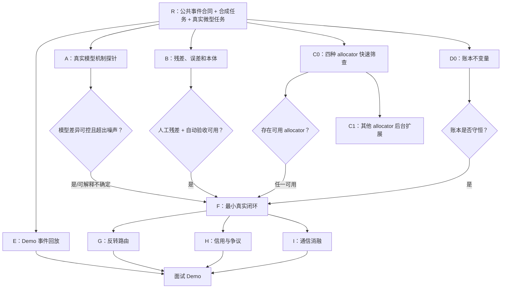

# 自组织 Agent 能量场架构：技术附录与并行实验修订 v0.5.1

## 0. 文档定位

本文是 v0.5 的增量研究规格，不覆盖 v0.5，也不回退到未经修正的 v0.4。

它同时解决两个问题：

1. v0.5 为了提高面试前执行效率，压缩了部分技术动机；
2. 新一轮对抗性审查指出，真实模型探针、任务残差误差、矛盾证据、taint propagation 和实验关键路径仍需加强。

本文作为当前首要阅读入口，包含：

- 经过纠错的技术核心；
- v0.5 并行实验 DAG 的修订；
- 面试前的最小验证标准；
- 机制失败时的收缩方式。

本文仍是一份可证伪研究规格，不代表场动力学、能量货币或多 Agent 分工已经被证明有效。

---

## 1. 核心架构命题

### 1.1 总命题

将多 Agent 系统视为一个开放的、反馈驱动的资源转换系统：

```text
外部目标、约束和资源
        ↓
任务本体与残差估计
        ↓
分配、探索和预算发放
        ↓
Agent 执行与资源消耗
        ↓
产物、证据和环境变化
        ↓
验证、争议和信用估计
        ↓
更新残差、能力后验和资源配置
        ↓
继续、重新探索、降级或终止
```

系统不从内部创造真实计算资源。反馈的作用是改变未来资源的流向，而不是恢复已经消耗的 token、时间或算力。

### 1.2 当前最小价值主张

在具有可分解结构、反馈可观察且环境可能变化的任务上，动态分工是否能够相对于单 Agent、固定分工和简单在线分配获得至少一种净收益：

- 固定成本下更高质量；
- 固定质量下更低成本；
- 相近成本和质量下更低延迟；
- 环境变化后更快恢复；
- 局部失败后更好的重新配置能力。

不要求多 Agent 在所有任务和所有指标上获胜。纯串行、低复杂度或协调成本占主导的任务应允许单 Agent 胜出。

### 1.3 当前不主张

- 行为不同就等于分工有价值；
- 场动力学一定优于 bandit 或匹配；
- 任务残差估计等于真实任务状态；
- 所有信用都能被精确归因；
- 所有风险都能被统一价格化；
- hidden-state 通信一定优于结构化文本；
- 一次 Demo 足以验证架构。

---

## 2. 任务表示、反馈与本体不确定性

### 2.1 真实残差与估计残差

真实但通常不可观测的任务残差：

\[
D_t^*=Residual^*(G,World_t)
\]

系统能够维护的只是：

\[
\hat D_t=ResidualEstimate(G,S_t,E_t,\Omega_t)
\]

- \(G\)：目标、约束和验收规则；
- \(S_t\)：当前已接受的任务状态；
- \(E_t\)：支持、反对和未知证据；
- \(\Omega_t\)：当前任务本体；
- \(\hat D_t\)：在当前本体和证据下的残差估计。

合成任务中可以直接比较 \(\hat D_t\) 与 \(D_t^*\)。真实任务中只能通过独立环境验收、人工标注或保留测试集估计外部有效性。

### 2.2 误差会通过闭环放大

系统同时使用 \(\hat D_t\) 进行：

- 任务分配；
- 反馈解释；
- 信用估计；
- 后续预算重分配。

因此残差误差不是普通测量噪声，而是闭环控制误差。即使单次估计误差较小，多轮相关偏差也可能形成稳定的错误吸引子。

当前必须测量的误差类型：

1. 独立随机噪声；
2. 持续系统偏差；
3. 某一需求维度遗漏；
4. 反馈延迟；
5. 多轮相关误差；
6. Verifier 对特定 Agent 或产物风格的偏好；
7. 需求权重估计错误。

核心鲁棒性曲线：

\[
NoiseLevel \rightarrow
Gain(AdaptiveAllocation, FixedAllocation)
\]

需要找到自适应分配收益消失、反转或变得不稳定的误差阈值。

### 2.3 out-of-ontology 不是普通残差

定义本体不确定性状态：

\[
O_t=OntologyUncertainty(Signals_t)
\]

`out_of_ontology` 信号不直接减少已有需求残差，而是：

- 进入 schema-review queue；
- 增加 \(O_t\)；
- 获得少量、受限的本体探索预算；
- 触发候选新需求生成；
- 经人工或高权威规则确认后升级任务 schema。

触发条件不能只按信号数量计算，还应考虑：

- 独立来源数；
- 与外部验收失败的相关性；
- 潜在任务影响；
- 证据可信度；
- 是否只是无法归类的低质量输出。

面试前范围中，系统可以自主检测本体缺口并提出候选修改，但正式改变任务本体需要人在环或确定性规则确认。

### 2.4 矛盾证据状态

Claim 的候选状态：

```text
unresolved
supported
contradicted
disputed
```

冲突处理：

1. 优先请求适用于该 claim 类型的环境级验证；
2. 环境无法判断时标记为 `disputed`；
3. 暂缓依赖该 claim 的完成信用；
4. 提高对应需求维度的不确定性；
5. 分配受限的争议解决预算；
6. 保留双方证据，不使用多数投票直接决定事实。

发现有效矛盾本身可能产生有限的信息贡献信用，但不能获得“任务已经完成”的信用。

`disputed` 不自动等于 `out_of_ontology`：前者是已知命题上的认识冲突，后者表示当前任务坐标可能缺失概念。

### 2.5 Schema migration 范围

面试前只验证需求维度新增：

- 新维度获得新的 schema version；
- 旧状态在该维度为 `unknown`；
- 重新检查已有证据是否已部分覆盖新维度；
- 迁移 allocation/capability；
- 无法迁移时局部重新分化。

维度拆分、合并和无版本号的语义漂移明确推迟。这三类问题不能被简单的坐标映射可靠解决。

---

## 3. Agent 状态与分配几何

### 3.1 Agent 状态

\[
Z_i(t)=\{C_i,A_i,Q_i,U_i,B_i,H_i\}
\]

- \(C_i\)：能力先验或后验；
- \(A_i\)：当前任务分配；
- \(Q_i\)：在各需求维度上的观测效用；
- \(U_i\)：能力和效用估计不确定性；
- \(B_i\)：资源余额；
- \(H_i\)：执行历史与可选慢状态。

能力、分配、效用和身份必须分开。不能因为某个 Agent 被分配了更多任务，就直接推断它具有更高能力。

### 3.2 Allocation 单纯形

\[
A_{i,k}\ge0,
\qquad
\sum_kA_{i,k}=Capacity_i
\]

分配倾向使用 simplex projection 或 mirror descent 更新，不使用可能产生负任务分配的普通 L2 归一化。

### 3.3 对称性破缺

系统承认需要外部或随机的不对称种子：

- 第一轮任务输入差异；
- 信息可见性差异；
- 拓扑位置差异；
- 随机探索；
- 执行历史差异。

更准确的主张是：

> 场动力学不从完全对称状态中凭空创造有意义角色；它尝试放大由任务和环境提供的微小差异，并抑制无价值重叠。

实验必须将第一次分配本身与后续动力学放大分开消融。

---

## 4. 场动力学的当前技术形式

### 4.1 目的

场动力学只是候选 allocator。它试图同时编码：

- 未满足需求吸引；
- 已观测效用；
- 探索不确定性；
- 维度拥塞；
- 资源和风险惩罚；
- 状态更新平滑性。

### 4.2 Mirror-descent 形式

定义 Agent \(i\) 在需求维度 \(k\) 上的局部驱动力：

\[
F_{i,k}(t)=
\beta\hat D_{t,k}\hat Q_{i,k}
+\chi U_{i,k}
-\lambda Congestion_{-i,k}
-\rho Cost_{i,k}
-\xi Risk_{i,k}
\]

更新：

\[
\widetilde A_{i,k}(t+1)
=
(A_{i,k}(t)+\epsilon)
\exp(\eta F_{i,k}(t))
\]

\[
A_i(t+1)=Capacity_i
\frac{\widetilde A_i(t+1)}
{\sum_k\widetilde A_{i,k}(t+1)}
\]

这一形式保持非负和容量约束。它是待验证启发式，不宣称具有一般收敛保证。

### 4.3 Congestion controller

\[
Coverage_{-i,k}
=
\sum_{j\ne i}A_{j,k}\hat Q_{j,k}
\]

\[
Congestion_{-i,k}
=
\sigma\left(
\frac{Coverage_{-i,k}-\theta_k}{\tau}
\right)
\]

它表示某一需求方向是否已经拥挤，不再称为两两余弦侧向抑制的数学近似。二者是不同控制器，应分别实验比较。

\(\hat Q\) 必须携带置信度；缺乏观测时不能把零效用当成已知低能力。

### 4.4 与简单控制器的关系

该问题也可以被描述为在线、有约束、非平稳的资源分配问题。因此场动力学必须与以下方法比较：

- 固定均分；
- UCB 或 Thompson Sampling；
- oracle 上界；
- 后续阶段的匹配或直接优化。

如果场动力学没有提供质量、适应性、可解释性或控制稳定性上的净收益，应使用更简单控制器替代。

---

## 5. 能量循环与资源账本

### 5.1 三种不同量

1. **真实资源**：token、时间、算力、通信、人工审核；
2. **任务进展**：\(\hat D_t\) 的证据支持变化；
3. **贡献信用**：影响未来预算的可撤销估计。

三者不能在底层混成一个标量。

### 5.2 账户

```text
SharedPool
AgentEscrow[i]
Reserved
Spent
```

守恒关系：

\[
SharedPool_t
+\sum_iAgentEscrow_{i,t}
+Reserved_t
+Spent_t
=
Initial+\sum_{\tau\le t}ExternalInjection_\tau
\]

grant 是账户间转移，spend 才是不可回收消耗。Router、Verifier、通信和 Demo instrumentation 的成本都要记账。

### 5.3 合法份额

\[
q=Project_{\mathcal C}(Softmax(z))
\]

\[
\mathcal C=
\{q:\sum_iq_i=1,\;l_i\le q_i\le u_i\}
\]

上下限必须满足可行性。未发放资源留在 SharedPool，不能从总账中消失。

### 5.4 风险不进入面试前统一货币

风险在当前 MVP 使用两层控制：

- 硬约束：禁止、需要审批、只读、可回滚；
- 观测记录：操作风险类别、影响范围和验证状态。

不在面试前尝试为写文件、执行命令或外部副作用设计通用风险价格。风险价格化属于后续独立研究。

---

## 6. 信用、语义图与派生 DAG

### 6.1 信用状态

```text
provisional
confirmed
rejected
expired
indirectly_tainted
```

provisional 信用可以按置信度有限参与分配，但不能只因为若干周期没有反证就自动 confirmed。

### 6.2 两张图

#### 语义证据图

允许循环，用于表达：

- supports；
- contradicts；
- conflicts_with；
- depends_on；
- references。

#### 时间版本化派生 DAG

只表达因果派生：

```text
Evidence v1
  → Feedback v1
  → Credit v1
  → Allocation v2
  → Action v2
  → Evidence v2
```

每条派生边必须从较早事件指向较晚事件，因此 taint propagation 沿该图天然无环。

### 6.3 Taint propagation

当证据被推翻：

1. 标记该证据版本为 rejected；
2. taint 直接派生的 Feedback/Credit；
3. taint 受其影响的能力后验和 allocation；
4. 将后续行动标记为 `possibly_affected`，不直接断言其产物错误；
5. 失效相关组织记忆；
6. 超过实时重算预算的后代标记为 `indirectly_tainted/recompute_deferred`。

深度上限只是计算保护，不能把上限之外的状态自动视为干净。

---

## 7. 与 MoE 的关系

MoE 只能作为类比，不是本架构的直接理论基础。

| 维度 | MoE | 本架构 |
|---|---|---|
| 执行单元 | 参数化 expert 子网络 | 有状态、可使用工具的 Agent |
| 专门化形成 | 主要在训练期间形成 | 任务执行期间通过状态和反馈形成 |
| 路由时机 | 训练和推理时按输入/token 动态路由 | 按需求、证据和执行周期路由 |
| 状态 | expert 本身通常不保存任务级私有历史 | Agent 保存任务状态和执行历史 |
| 反馈 | 训练 loss 梯度 | 环境结果、验证、信用和成本 |
| 容量 | 每层 token/expert capacity | Agent 资源、工具和并发容量 |

Expert Choice 的启发在于让 expert 选择有限输入以改善负载平衡。本架构的反转路由借鉴这种方向，但工作单元是任务需求而不是 token，反馈和时间尺度也不同。

更准确的定位是：

> 本架构研究运行时、有状态、带反馈和工具作用的 Agent 资源分配；它同时接近 MoE 路由、在线 bandit、匹配和多 Agent orchestration，但不等同于其中任何一种。

---

## 8. 修订后的并行实验 DAG



F 不等待 C1 完成。C0 只需找到一个稳定可运行的 allocator。

---

## 9. Branch A：真实模型机制与价值筛查

### 9.1 A0：机制探针

比较：

1. 相同输入、相同历史；
2. 不同输入、相同历史；
3. 相同输入、不同历史；
4. 交换 Agent 标识；
5. 交换任务；
6. 清空历史。

目的：分离采样噪声、输入效应、历史效应和标签效应。

### 9.2 A1：廉价分工—集中筛查

在相同实际成本上比较：

- 一个 Agent 完成完整微型任务；
- 多个 Agent 分工后合并；
- 多个独立 Agent 直接投票/选择，不分工。

该筛查只判断是否出现明显负收益，不承担整个架构的最终价值证明。

任务集至少包含：

- 低可分解任务；
- 高可分解任务；
- 存在依赖的任务。

如果多 Agent 只在高可分解任务中有效，结论应写成条件性适用范围，而不是架构失败。

### 9.3 Branch A 判定

- `support`：分配或历史效应稳定超过采样噪声，并在至少一种合理任务结构上不产生明显净损失；
- `inconclusive`：存在行为差异，但质量效应不稳定；
- `reject`：差异主要来自标签或采样，分配/历史无法稳定控制。

---

## 10. Branch B：残差、误差和本体

### 10.1 B0：人工任务残差

使用人工需求和自动验收验证：

- 状态更新一致性；
- 证据到残差的可追溯性；
- 完成条件；
- disputed claim；
- schema version。

### 10.2 B1：残差误差注入

为 \(\hat D_t\) 注入不同类型和强度的误差，测量：

- 固定分配收益；
- 自适应分配收益；
- 错误赢家集中度；
- 预算震荡；
- 恢复时间；
- 任务最终质量。

主要产物不是一个通过/失败数字，而是一条鲁棒性曲线和安全工作区间。

### 10.3 B2：需求维度新增

只验证维度新增和历史证据回填，不验证拆分、合并或语义漂移。

### 10.4 B3：本体不确定性

验证：

- 无法归类证据是否进入 review queue；
- 低质量输出是否会错误触发 schema review；
- 独立来源和外部验收失败能否提高触发可信度；
- 未确认前是否避免直接改写任务目标。

---

## 11. Branch C：精简 allocator 筛查

### 11.1 C0 必须基线

1. 固定均分；
2. UCB 或 Thompson Sampling，第一轮只实现一个；
3. 场动力学；
4. oracle 上界。

单 Agent 作为端到端价值基线放在 Branch A/F，不与纯 allocator 使用完全相同的内部指标比较。

### 11.2 非阻塞规则

- 只要任意一个 allocator 稳定运行，F 就可以开始；
- 场动力学失败时使用 UCB 或固定分配进入 F；
- C1 在后台补充贪心、匹配和其他非平稳方法；
- 学习型神经 Router 面试前推迟，不解决冷启动与训练数据自举。

### 11.3 场动力学停止条件

如果场动力学不能相对于简单自适应方法提供质量、适应性、稳定性或解释性中的任何净收益，就不再作为架构核心优势。

---

## 12. Branch D：账本和反馈鲁棒性

### 12.1 D0 账本

验证：

- event idempotency；
- grant 内部转移；
- spend 不可回收；
- reserve/return/expire；
- 并发结算；
- Router、Verifier、通信开销；
- 余额不为负；
- 总量不变量。

### 12.2 D1 反馈再分配

比较固定均分、自适应分配和环境突变后的重启策略。D1 直接消费 B1 的误差模型，不再默认反馈正确。

要证明：

> 在可识别的误差工作区间内，反馈再分配能够产生净收益；超过该区间时，系统能够降级到固定分配或请求外部校正。

---

## 13. 最小真实闭环 F

### 13.1 前置条件

- A 至少为 `support` 或可解释的 `inconclusive`；
- B0 人工残差可用；
- C0 至少一个 allocator 可运行；
- D0 账本通过。

### 13.2 对照组

- 单 Agent；
- 固定分工；
- 多 Agent 独立采样后选择；
- 反馈驱动动态分工；
- 如果仍被支持：场动力学。

### 13.3 主指标

第一主结论：

> 在固定实际成本上，哪种方法获得更高任务质量？

第二主结论：

> 达到固定质量目标时，哪种方法成本更低？

另外报告：

- 端到端延迟；
- 峰值资源；
- 控制成本；
- 失败率；
- 需求变化后的恢复时间。

Pareto 图保留，但不能替代预注册的主比较。

---

## 14. Demo 修订

### 14.1 Demo 目标

展示：

- 任务残差与不确定性；
- 分配和预算变化；
- 证据支持、矛盾和 disputed；
- provisional/confirmed/tainted credit；
- 环境变化后的重新路由；
- 当前使用的 allocator；
- 单 Agent 和固定分工结果。

### 14.2 任务选择

选择自然具有以下特征的任务：

- 可并行子任务；
- 至少一个串行依赖；
- 信息分区或不同参考材料；
- 中途需求变化；
- 可自动验收；
- 一个可恢复的错误证据。

不通过人为限制单 Agent context window 来保证多 Agent 获胜。若不同 Agent 具有不同工具或数据访问权限，必须将其作为明确实验条件，而不是隐藏优势。

### 14.3 Demo 成功标准

Demo 成功表示闭环和可观察性可靠，不表示多 Agent 必然优于单 Agent。价值结论来自 F 的对照实验。

---

## 15. 时间盒

在面试日期尚未确定时使用相对优先级。

### 剩余不超过 5 个有效工作日

1. 公共事件合同；
2. A0/A1；
3. B0；
4. D0；
5. 固定均分 + UCB + 场动力学快速筛查；
6. 最小闭环和事件回放 Demo。

### 剩余 6–10 个有效工作日

在上述基础上增加：

- B1 残差误差曲线；
- G 反转路由；
- disputed claim；
- taint DAG；
- 一次环境突变实验。

### 剩余超过 10 个有效工作日

再增加：

- 信用归因对照；
- 通信删除/置换消融；
- schema dimension addition；
- 更完整 allocator baselines；
- 技术报告和可视化完善。

hidden-state、异构对齐和长期记忆不进入面试前关键路径。

---

## 16. 主张登记表

| 主张 | 状态 | 验证位置 |
|---|---|---|
| 真实模型差异可由输入或历史控制 | open | A0 |
| 分化相对集中执行至少在部分任务有价值 | open | A1/F |
| \(\hat D_t\) 在有限误差区间内可用于控制 | open | B1/D1 |
| 本体缺口可被检测并进入审查 | defined | B3 |
| disputed claim 不会被错误结算为完成 | defined | B0/H |
| 场动力学具有简单方法之外的净收益 | open | C0/F |
| 资源账本保持守恒和幂等 | defined | D0 |
| 反馈错误过大时系统能够安全降级 | open | B1/D1 |
| 反转路由减少错误赢家锁定 | open | G |
| taint 可沿时间派生 DAG 传播 | defined | H |
| Demo 可复现事件闭环 | defined | E/Demo |
| latent communication 优于文本 | deferred | 面试后 |

---

## 17. 面试叙事

推荐叙述顺序：

1. 从固定角色多 Agent 的重复、锁定和反馈缺失问题出发；
2. 提出任务残差、真实资源和可撤销信用三层模型；
3. 解释反转路由如何提供早期验证机会；
4. 承认残差是估计量，并展示误差鲁棒性实验；
5. 展示场动力学与 UCB 等简单方法的真实比较；
6. 展示最小闭环和事件账本；
7. 明确哪些机制被支持、被拒绝或仍未决。

最有价值的结果不是所有机制成功，而是能够说明：

- 哪些现象真实存在；
- 哪些只在特定任务条件下成立；
- 哪些简单方法已经足够；
- 哪些复杂机制值得继续研究；
- 系统如何在反馈不可靠时降级。

---

## 18. 停止原则

以下情况出现时应收缩架构：

- 模型行为差异无法超过采样噪声；
- 分工在合理任务集上持续劣于集中执行；
- 残差误差在现实水平下使反馈分配劣于固定均分；
- 场动力学不优于更简单在线策略；
- 控制成本抵消执行收益；
- disputed 和 taint 无法在可接受成本内维护；
- 结论只存在于单一任务、单一种子或事后选择参数；
- Demo 曲线看起来合理，但外部验收和原始数据不支持结论。

对应机制失败时，应替换或删除机制，而不是继续增加参数保护理论。
