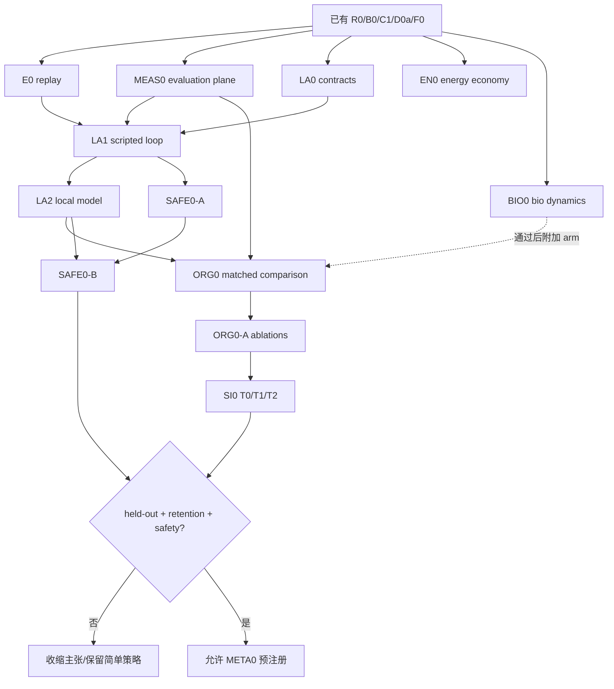

# Biofield 实验路线图复核 v1：局部主体性重设计

日期：2026-07-21

状态：**supporting decision record; execution order superseded 2026-07-30**

本文保留 2026-07-21 从中央 allocator 主线转回局部主体性的决策过程，不再作为当前执行优先级。当前 D/O1/O2 研究定义以[核心研究命题](../research/BIOFIELD_CORE_RESEARCH_THESIS.md)为准，实验顺序和门槛以[实验协议](./EXPERIMENT_PROTOCOL.md)为准，现实进度以[项目状态页](../STATUS.md)为准。本文以下内容作为路线演进记录保留，不为统一新术语而整体改写。

2026-07-31 进度注：canonical v3 sealed evidence（含原始 fixture 字节闭包）支持 E0 Gate 0；LA0 contract layer 已通过审阅，LA1 canonical v8 / runner v5 的 §7.3/§7.5 scripted technical criteria 已满足并补齐 native state provenance，但 formal claim-bearing Gate 1 activation 仍等待 Gate M。MEAS0 canonical foundation 已更新为 `runs/meas0/pilot/meas0-foundation-20260731-v27`：schema-v2 自包含 lock 绑定 29 个 source，run 为 36 cases / 180 results、36/36 task-native，三次 replay hash 一致。formal runner v6 的 trust/cost/oracle 边界、两套 288-call exact invocation、证据驱动 lifecycle 和 write-once formal store 已接入；没有生产 authority、真实 Judge、formal 或 confirmatory evidence，Gate M 仍为 `FAIL`。当前边界见 [E0 Gate 0 V2](../../results/E0_GATE0_V2.md)、[LA0 Contract V1](../../results/LA0_CONTRACT_V1.md)、[LA1 Scripted Technical V4](../../results/LA1_SCRIPTED_TECHNICAL_V4.md) 与 [MEAS0 Foundation V11](../../results/MEAS0_FOUNDATION_V11.md)；历史版本保留审计。

## 1. 决策

此前路线把 F0 之后的主线定义为：继续完善中央 allocator、路由表示、反馈鲁棒性和分工对照。这条路线能够研究“中央控制器如何优化多 Agent”，但不能直接回答原始 Biofield 的问题：组织能否由 Agent 的局部感知、私有状态、选择、拒绝和通信逐步形成。

本次路线调整采纳 [局部主体性复盘](../architecture/BIOFIELD_LOCAL_AGENCY_REVIEW_2026-07-21.md)，并以 [当前架构规格](../architecture/ARCHITECTURE_EXPLORATION_FINAL.md) 为准：

- Harness 保留目标、事实、权限、Ledger、准入、终态和回滚；Evaluation Plane 独立持有正式 MeasurementGraph/MeasurementSpec、evaluator 和 EvaluationResult；
- Agent 重新获得合法行动候选的产生权；
- Field 从中央 Allocation 生成器改为局部可感知信号；
- Equal/UCB/FieldAllocator 保留为中央基线，不再代表 Biofield 主路径；
- TaskFrame/GoalGraph、Agent 的 PlanGraph、实际 EpisodeGraph 与正式 MeasurementGraph 分离；它们共享 TaskContract 引用，但正式 MeasurementSpec 和 evaluator 独立于被评 Agent；
- 真实资源、可交付权利、任务残差、贡献信用和动态价格保持分层；
- 新主线先冻结任务测量并验证局部主体合同，再比较组织价值，最后才评估纵向自改进；
- 宏观能量经济 EN0 与生物动力学 BIO0 分轨验证，不提前并入主架构；
- meta-evolution 不进入当前承诺。

## 2. 已完成证据如何继承

| 已完成工作 | 保留价值 | 不支持的主张 |
|---|---|---|
| R0-min | schema、run lifecycle、sealing、终态写保护 | 局部主体性 |
| B0 | Evidence/Feedback/Residual 的确定性状态变化 | 真实模型能形成组织 |
| D0a | 资源守恒、幂等和异常结算 | Agent 可自主分配资源 |
| C-pre0 | 向量机制的数值诊断 | 真实 Agent 分化 |
| C1 | Equal/UCB/Field 中央策略比较接口 | Field 有组织增量价值 |
| A0/A0a | 模型合同、位置和菜单偏差 | 稳健的经验路由 |
| F0-contract | Harness 闭环和失败路径 | 动态组织 |
| F0-model | 真实 action/evidence/feedback/settlement 轨迹 | 多 Agent 净收益或自改进 |

历史结果不重跑，也不因主线改变而降格。它们成为新实验的基线、fixture 和失败边界。

## 3. 停止的旧主线

以下工作从当前主线移除：

- 继续扩展 A0a 人工 history、opaque ID 或 Prompt 路由探针；
- 在局部主体合同缺失时继续优化中央 FieldAllocator；
- 把 L0 表示桥作为 F0 后的第一优先级；
- 直接把 `predefined_role` 与 FieldAllocator 的差异称为分化；
- 在单次任务上增加更多角色或通信轮次来展示“涌现”；
- 在没有 T0/T1/T2、held-out 和 retention 时讨论自改进；
- 让 Agent 修改正式 Goal/Requirement、MeasurementGraph/MeasurementSpec、evaluator、权限、Ledger 或实验评分规则。

L0 的有效部分被吸收到 LA2 和 SI0：状态必须来自真实事件窗口，并通过 state reset/no-state 消融验证。

能量、金融、生物和任务测量的概念边界与可证伪假设见 [独立研究议程](../research/ENERGY_MEASUREMENT_BIO_RESEARCH_AGENDA_2026-07-21.md)。

## 4. 新的阶段顺序

### P0：冻结现有 Harness 证据

状态：F0 已完成，E0 Gate 0 已通过。

1. 把 F0 的 settlement 接入公共事件流；
2. 实现全量 replay 和 checkpoint replay；
3. 冲突重复、缺父事件、终态后事件 fail closed；
4. 封存当前 `predefined_role` 和中央 allocator 基线。

完成条件：相同 sealed 事件得到相同公共终态哈希。

### P1：任务测量与独立评测

实验：MEAS0。

冻结设计见 [MEAS0 任务测量平面实验设计 V1](./MEAS0_DESIGN_V1.md)。截至 2026-07-31，canonical v27 foundation 已保存 36 cases / 180 results；36/36 task-native，三次 replay hash 一致。其 schema-v2 自包含 lock 绑定 29 个 source 和批准规则；trust/cost/oracle ancestry、288-call exact invocation、独立 J-AUDIT、formal lifecycle/store 已定义并在生产输入缺失时 fail closed，但没有真实 DeepSeek V4 Pro protected/trusted J-CAL/J-AUDIT、人工 gold、正式 detection oracle、正式进程 ACL/preflight、经签名并独立复核的 formal comparison lock 或正式 Pilot/confirmatory，故 Gate M 仍未通过。

先以 TDD 冻结：

- `TaskFrame` 与 `GoalGraph`；
- `RequirementGraph`；
- 独立于 Agent `PlanGraph` 的 `MeasurementGraph`；
- `MeasurementSpec`；
- `TaskMeasurementBundle`；
- `EvaluationResult`；
- `pass/fail/unknown/disputed` 状态；
- state/rule/Judge/human escalation 的优先级；
- evaluator isolation、版本、校准和成本记录；
- `RequirementProposal`/`OntologyRevisionProposal` 的批准与迁移规则。

必须比较 self-eval、Judge-only、state-only、rules+state 和固定混合 Evaluation Plane，并注入“文本正确但状态未变”“状态完成但过程越权”“代码测试通过但端到端任务未完成”“遗漏需求维度”“Judge 顺序偏差”“等价输入变换后结果异常变化”等场景。

完成条件：正式 accepted 结果全部可追溯到冻结测量规则和环境/证据父事件；被评 Agent 不能改变规则；`unknown/disputed` 不被静默视为通过；ORG0 所需测量包已冻结。

MEAS0 通过后可启动不阻塞 LA0/LA1 的测量研究扩展：

- `MEAS1`：蜕变测试与主动风险加权测量，比较固定全量、固定最小和动态选择下一测量；
- `MEAS2`：数据量足够后研究任务难度/区分度、自适应任务选择和因果重放。

MEAS1/MEAS2 不因概念新颖而自动进入主路径；只有在相同错误率下降低测量成本、相同成本下降低错误接受，或提供固定基线无法得到的因果诊断时才允许升级。完整研究定义见[任务测量研究文档](../research/AGENT_TASK_MEASUREMENT_RESEARCH_2026-07-21.md)。

### P2：局部主体合同

实验：LA0。

先以 TDD 实现：

- `LocalFieldObservation`；
- `AgentIntent`；
- `AgentBid`；
- `AgentCommitment`；
- `AgentRefusal`；
- `CommunicationOffer/Request`；
- `LocalStateUpdate`；
- `OrganizationSnapshot`；
- `UpdateSurfaceManifest` 和 `ExperienceUpdateRecord`；
- deterministic Admission resolver。

完成条件：Agent 只能提案，Harness 独占公共事实、权限、资源和提交权；所有越权、版本、因果和终态错误均 fail closed。

### P3：确定性局部闭环

实验：LA1。

使用 scripted agents，不使用 LLM，跑通：

```text
Task/Residual
  → LocalFieldObservation
  → Intent/Bid/Refusal
  → Admission/Commitment
  → Action/Evidence/Feedback
  → Residual/Ledger
  → LocalStateUpdate
  → next observation
```

必须包含冲突投标、主动拒绝、通信、rejected/disputed feedback、Agent 失效接管、资源不足和 checkpoint 恢复。

完成条件：公共状态可重放、Ledger 守恒、私有状态版本可追溯，且 Harness 没有替 Agent 产生 Intent。

### P4：真实本地模型合同

实验：LA2。

将 scripted decision policy 替换为本地 `qwen3:8b`，保留冻结的 Harness/Admission/Evaluation Plane。主要评估结构合法率、Refusal 校准、成本估计、ID/顺序稳健性和真实事件到状态更新的一致性。

完成条件：模型输出错误只能成为 rejected proposal，不能产生越权动作；合同成功率足以支持组织对照，而不是主要依赖 schema repair。

### P5：组织价值与因果消融

实验：ORG0/ORG0-A。

主要 arm：

- Single；
- Fixed `predefined_role`；
- Central UCB；
- Local-no-field；
- Local-field。

所有 arm 匹配模型、工具、任务、TaskMeasurementBundle/evaluator、总 token/调用预算和停止规则。通信、反思、Bid 和状态更新全部计费。

关键差分：

- Local-no-field vs Central：局部行动权；
- Local-field vs Local-no-field：Field 增量；
- Local-field vs Fixed：动态组织总效应；
- Local-field vs Single：多 Agent 净收益。

必做消融：state reset、no-field、topology freeze、communication shuffle、Agent ID permutation、compute match 和 capability equalization。

完成条件：确认实验表明至少一个预注册主要差分成立，且结构消融造成可预测退化。否则收缩为局部协调或中央 Harness 研究。

### P6：纵向经验驱动改进

实验：SI0。

在 R3 的 replay/adapt/held-out partition 上运行同一 evolving system：

```text
T0 → Adapt → T1 → Delay/Drift → T2
```

同时报告：held-out gain、backward retention、longitudinal stability、improvement efficiency、path attribution 和 safety non-regression。

完成条件：held-out 提升、旧能力保留、T2 稳定、等成本成立、路径可归因且安全不退化。只在 adapt stream 上涨分不通过。

### P7：攻击、回滚和持续治理

实验：SAFE0。

覆盖 poisoned local state、stale experience、恶意通信、反馈污染、Bid spam、Agent compromise propagation 和 sealed checkpoint rollback。

SAFE0-A 可以在 LA1 后启动；SAFE0-B 与 ORG0/SI0 并行。安全失败会阻止 SI 主张升级，但不阻止记录局部组织的任务指标。

### P8：独立研究支线

#### EN0：能量经济模拟

比较单一 Energy Token、多维资源账本、以及“多维账本 + 转换网络 + DeliveryClaim + 信用/价格”。只运行合成模拟，不连接真实金融系统，不阻塞 E0/LA0/LA1。

#### BIO0：生物动力学消融

每次只测试一个机制：膜式阈值、资源消耗的状态维持、选择性通道、局部侧向抑制或可逆生态位。每个机制必须先有 `AnalogyTransferContract`，并优于对应普通阈值、队列、拥塞或广播基线后，才允许进入 ORG0 附加 arm。

### P9：Meta 层，仅条件触发

META0 只有在 ORG0、SI0 和 SAFE0 同时通过后才允许预注册。当前不设计实现，不把 LocalStateUpdate 或动态通信称为 meta-evolution。

## 5. 当前可执行 DAG



## 6. 近期实现批次

### Batch 1：E0、MEAS0 与 LA0

可以并行开发，但每个行为都先写失败测试。

产物：

- settlement public event adapter；
- replay/checkpoint tests；
- TaskMeasurementBundle 和 evaluator isolation tests；
- state/rule/Judge/self-eval 对照 fixture；
- 新合同 dataclasses/schema；
- 权限矩阵 tests；
- Admission resolver tests；
- 架构到代码的明确 mapping。

当前 `MEAS0-S0` 已交付合同、隔离规则测试和抽象对照 fixture；canonical v27 foundation 已完成 N=36/五臂离线执行、36/180、36/36 native、replay/seal、预算执行和 case-indexed artifact，三次 replay hash 一致。schema-v2 自包含 lock 绑定 29 个 source 与批准规则；formal runner v6 保留 StageCost/receipt ancestry；readiness 增加两套 288-call exact invocation 与 corpus 隔离；formal lifecycle/store 已实现，production raw authorization 可在回放时由外部 verifier 重验，但当前 candidate package仍不可正式使用。production roots/keys、批准 price/budget、正式 oracle、production backend、真实 formal package、正式 comparison lock 和 formal/confirmatory evidence仍未交付。

### Batch 2：LA1

只使用 scripted agents。若这一层无法稳定，不启动模型调 Prompt。

产物：

- local-agency orchestrator；
- 至少一个成功和一个失败恢复 sealed run；
- organization snapshot；
- LA1 规范结果报告。

### Batch 3：LA2 Pilot

使用本地模型和 R1/R2。先估计合同有效率和位置偏差，再冻结确认配置。

### Batch 4：ORG0 Pilot

只在 LA2 工程门槛通过后启动。Pilot 用于估计方差和冻结确认实验，不写强结论。

### Independent Track：EN0 与 BIO0

EN0 可以与 Batch 1 并行，只产生合成模拟和研究报告。BIO0 可以先用确定性 scripted fixture，但任何机制接入 ORG0 前必须完成单机制消融、顺序/ID 稳健性和简单基线比较。

## 7. 每批停止门槛

### E0/MEAS0/LA0 停止

- 无法保证 replay determinism；
- 被评 Agent 可以修改正式 Goal/Requirement、MeasurementGraph/MeasurementSpec、Judge 或 acceptance rule；
- Judge-only 无法校准且混合评测不优于简单 rules+state；
- `unknown/disputed` 被迫压成二值结果；
- 新合同允许 Agent 绕过公共权威；
- 私有状态无法做最低 provenance；
- 新增能力需要修改历史结果或弱化 sealing。

### LA1/LA2 停止

- scripted agents 下仍需要中央生成具体 Intent；
- 真实模型主要输出无效 schema；
- Refusal/Communication 只是装饰，不改变后续行为；
- 顺序偏差无法通过 block/randomization 控制；
- 协调开销在微任务上已经超过任务预算。

### ORG0 停止

- Local 持续输给 Fixed/Central；
- Local-field 与 Local-no-field 无差异；
- 优势在 compute match 后消失；
- state reset 或 topology 消融不影响表现；
- Agent ID 置换翻转结论；
- 所谓组织收益只来自一个更强的个体 Agent。

### SI0 停止

- 只有 adapt tasks 提升；
- replay 严重遗忘；
- T1 收益在 T2 消失或振荡；
- 不能定位收益来自哪个更新面；
- 单位增益成本不可接受；
- 安全、权限或回滚指标退化。

### EN0/BIO0 停止

- 多维账本没有比单一标量更好地定位瓶颈；
- DeliveryClaim/信用层不优于更简单 typed ledger；
- 生物机制只优于无机制，却不优于普通阈值、队列或局部广播；
- 结果依赖 Agent ID、候选顺序或有利初态；
- 多机制同时加入，无法做单机制归因；
- 接入需要弱化 Harness 权限、Ledger 守恒或可重放性。

## 8. 近期不做事项

- 参数训练、LoRA、在线 RL；
- Agent 自主安装第三方 Skill；
- Agent 修改 Harness、正式 Goal/Requirement、MeasurementGraph/MeasurementSpec、evaluator、Ledger 或安全策略；
- 公共网络、真实凭据或不可逆工具副作用；
- hidden-state/latent Agent 通信；
- 大规模开放世界任务；
- 继续增加新的架构历史版本；
- 为展示效果预写自然语言角色；
- 在确认实验前调出一个综合“能量”分数。
- 把宏观能量货币接入真实支付、交易或金融系统；
- 未经 AnalogyTransferContract 就把生物术语直接变成运行时对象。

## 9. 完整交付定义

本轮重设计只有同时交付以下内容才算从文档进入工程：

1. 当前架构规格和实验协议一致；
2. E0 可重放现有 F0；
3. MEAS0 测量合同、evaluator isolation 和对照 fixture；
4. LA0 合同与权限 tests；
5. LA1 scripted sealed run；
6. LA2 本地模型规范结果；
7. ORG0 等成本 Pilot 与预注册确认设计；
8. SI0/SAFE0 即使未运行，也有冻结的 fixture、partition、指标和停止门槛；
9. EN0/BIO0 至少有独立配置、基线、指标和拒绝条件，不要求在主线前获得正结果；
10. README 明确区分已实现基线与未实现目标。

在第 4 项完成前，项目对外仍应描述为“确定性 Agent Experiment Harness 加局部主体性研究设计”；在 ORG0/SI0 通过前，不描述为已经实现自组织或自改进。
