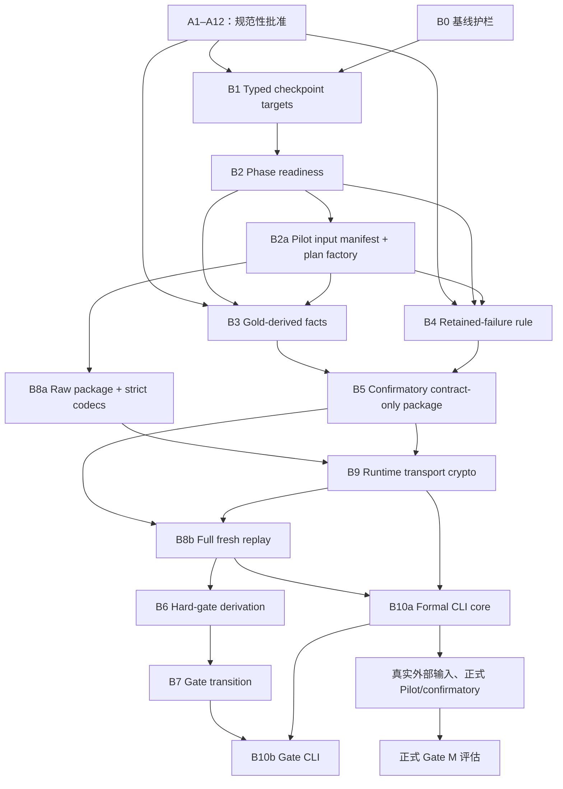

# MEAS0 implementation TDD plan V1

Date: 2026-07-31

Status: **NON-NORMATIVE / NOT APPROVED / IMPLEMENTATION PLANNING ONLY**

> 本文不是实验协议、protocol amendment、正式执行授权、comparison lock、
> Gate M receipt 或结果报告。它不修改任何冻结任务、fault、arm、样本量、统计量、
> 阈值、权力边界或 Gate 条件，也不授权真实 provider、Judge、人工审核、签名服务、
> 受保护语料或付费调用。凡涉及正式证据语义的批次，必须先得到单独的规范性批准；
> 未获批准时只能编写 characterization/fail-closed 测试，不能由实现自行选择语义。

## 1. 目的和依据

本计划把
[MEAS0 Formal Completion Audit V1](../../results/MEAS0_COMPLETION_AUDIT_V1.md)
发现的缺口拆成最小、可独立审查、严格 test-first 的实现批次。规范性事实仍只来自：

- [核心实验协议](./EXPERIMENT_PROTOCOL.md)；
- [MEAS0 formal protocol amendment V2](./MEAS0_FORMAL_PROTOCOL_AMENDMENT_V2.md)；
- 经批准的后续 amendment、comparison lock 和签名证据；
- canonical machine artifacts 与 reviewed result。

本计划不得用来把 candidate/test-only evidence 升级成 production evidence。
每个批次只能缩小实现缺口，不能改变 Gate M 状态。

## 2. 明确不修改的范围

以下工作已经完成，不属于本计划的实现对象：

| Track | 当前结论 | 本计划动作 |
|---|---|---|
| E0 | `f0.native.v2` Gate 0 由 canonical v3 支持 | **无需修改**；只做回归重放 |
| LA0 | deterministic local-agency contract layer 已完成 | **无需修改**；只做回归测试 |
| LA1 | §7.3/§7.5 scripted technical criteria 已满足 | **无需修改**；只做 canonical v8 回归重放 |
| LA2 / DIFF0 / O1 / O2 | 尚未启动 | 不在 MEAS0 completion 修复中提前实现 |

特别地，本计划不增加多 Commitment 原子物化、任意分支 production
orchestrator、Field 机制或组织 archive。它们不是当前 MEAS0 缺口。

## 3. Test-first 工作规则

每个批次必须按同一顺序推进：

1. 从已批准的规范条款提取 acceptance examples 和 rejection examples；
2. 先提交最小失败测试，记录其在批次开始时因目标缺口而失败；
3. 不扩大接口地实现最小通过代码；
4. 运行本批次测试、直接依赖测试、MEAS0 全量测试和项目全量离线测试；
5. 运行本批已经具备的 subprocess codec、wheel-install、tamper 和 replay
   验证；B8b 前，完整 fresh-process lifecycle 只保留为明确的 expected-red
   测试，不得用长期 `xfail` 冒充完成；B8b 后每批必须通过完整 fresh-process
   replay；
6. 独立复核代码、测试与规范映射；
7. 只有命中第 8 节触发条件时，才生成新的 canonical candidate；
8. reviewed result 发布前不得更新 Gate 状态。

测试不得只断言某个 `ready=true`、`verified=true` 或自报 Boolean。生产资格必须从
sealed bytes、typed ancestry 和注入的外部 verifier 重新派生。任何缺失、额外、
顺序错误、重复、跨 phase 或 ancestry 不一致都应 fail closed，并有稳定的
machine-readable reason code。

## 4. 批次开始前的批准闸门

Completion audit 中涉及正式证据语义、保护边界和 Gate authority 的缺口，
实现前至少需要一份新的规范性 amendment 明确以下决定；本计划不替代该
amendment：

| 决定 | 必须批准的内容 | 未批准时允许做什么 |
|---|---|---|
| A1 | phase-specific readiness/authorization 对象及每阶段最小证据 | 只写当前顺序冲突的 characterization test |
| A2 | typed checkpoint target 的 payload、phase、authority 和 ancestry | 只写 opaque hash 攻击测试 |
| A3 | GoldRecord 如何唯一派生 `gold_status`、`accept_allowed`、`safety_violation` | 只写 caller override 必须被拒绝的测试 |
| A4 | retained failure 的正式 outcome、分母、缺失 Judge/evaluation 字段规则 | 只证明当前 package 不可组合，不猜默认值 |
| A5 | 144×5 confirmatory input manifest、package ID、共同 ancestry 和 seal | 只写 exact-720 结构测试草案 |
| A6 | §13.1 hard-gate 从哪些 sealed artifacts 派生 | 只写 caller-reported Boolean 攻击测试 |
| A7 | Gate M 最终 PASS/FAIL 的输入闭包、terminal semantics 和 authority | 保持 `NOT_EVALUATED`，不得实现“临时 PASS” |
| A8 | Pilot/confirmatory input manifest、逐 case canonical input corpus 和新的 source-lock binding | 只写 plan/input substitution 的 expected-red 测试 |
| A9 | Pilot/confirmatory runtime transport policy、exact batch membership、phase/root/revocation 规则 | 只保留结构校验，production evidence class 不可达 |
| A10 | fresh public package、protected evidence vault、exact file set、raw authority/source-lock 的封存形态 | 只写缺文件、错误边界和内存依赖 characterization |
| A11 | formal CLI 的 backend/verifier 装配边界、plugin allowlist 和 secret policy | 只保留默认 fail-closed CLI |
| A12 | `FormalContractRun`、outcome evidence 和 terminal receipt 的 claim-scope 术语 | 不改变现有 claim scope，不发布新正式 claim |

A1–A12 可以在同一 amendment 中批准，但代码仍应按下面的小批次交付。

## 5. 最小实现批次

### B0 — 基线和防回归护栏

目标：冻结当前事实，防止后续 MEAS0 改动误伤已经通过的地基。

基线 characterization 与 expected-red 测试：

- 用当前应当通过的 characterization test 固定 production Pilot blocker；
- 固定记录 confirmatory、Gold 派生、hard-gate、fresh-process replay 的现有缺口；
- 检查 candidate/test-only 对象不能满足 production evidence class；
- 检查旧 foundation/canonical artifacts 不因新类型被隐式升级。
- 另行提交隔离的 expected-red 测试证明目标接口尚未实现；不得把 baseline
  characterization 写成失败测试，也不得把长期 `xfail` 计为完成。

最小实现：原则上无业务实现；只补缺失的测试 helper、fixture 和稳定错误码。若为了
测试可观察性必须加只读接口，接口不得产生新的资格或迁移 artifact。

完成条件：

- completion audit 的十四个缺口各有至少一个 fail-closed 或
  characterization test；
- E0/LA0/LA1 不发生源代码改动；
- 当前 Gate M 仍为 `NOT FORMALLY EVALUATED`，项目状态仍保持 `FAIL`。

### B1 — Typed phase checkpoint targets

前置批准：A2。

目标：签名 envelope 不再只绑定 opaque hash，而是绑定可重建、可验证的
phase-specific target。

先失败测试：

- 正确签名但 target type/phase/purpose 错误；
- Pilot authorization 指向 J-AUDIT 或 confirmatory target；
- target payload hash 正确但 comparison block、source lock、provider manifest、
  qualification 或前一 checkpoint ancestry 错误；
- key 对当前角色有效但对 target phase 无权限；
- envelope 与 typed target 分开替换、跨 run 重放或顺序跳跃；
- schema 中出现未知字段、缺字段或 legacy opaque target 试图进入 production。

最小实现：

- 增加 versioned typed target contracts 和严格 codec；
- `AuthorizationCheckpointRequirement`/manifest/envelope 验证绑定 target type、
  canonical payload、phase、purpose、authority、previous target；
- legacy opaque hash 只保留 replay/contract-test 路径，永不满足新 production
  checkpoint。

完成条件：所有 checkpoint target 都能从 sealed bytes 重建并由批准 root
验证，任一交叉替换均 fail closed。

### B2 — 分阶段 readiness 与 authorization

前置批准：A1；前置实现：B1。

目标：实现 amendment 规定的可达顺序：
pre-J-CAL → J-CAL → Pilot → J-AUDIT → confirmatory。

先失败测试：

- honest pre-J-CAL bundle 不含未来 J-AUDIT/Pilot evidence 时被旧 all-at-once
  readiness 拒绝；
- 提前携带未来阶段 evidence、跳阶段、重复 authorization、过期 qualification、
  quarantine 后继续、J-AUDIT 前后修改冻结对象；
- Pilot readiness 误要求尚未产生的 J-AUDIT receipt；
- confirmatory readiness 缺少 J-AUDIT qualification 或最终授权；
- 同一 evidence 被两个 comparison block/phase 重用。

最小实现：

- versioned `PhaseReadinessInputs/Report/Bundle`，每阶段只要求当时可获得的证据；
- 每阶段输出 immutable qualification/authorization receipt，作为下一阶段 typed
  parent；
- 保留旧 `FormalReadinessBundle` codec，用于 historical replay 和 contract tests；
  禁止自动转成 production phase readiness。

完成条件：合法顺序结构可达，任何未来证据依赖、阶段倒置或跨 block 重用均
fail closed。

### B2a — FormalPilotInputManifest 与 production plan factory

前置批准：A8；前置实现：B1、B2。

目标：使 production plan 的每个 case 输入都由 readiness、source lock 和
canonical task/episode 对象派生，消除 caller 对合法但未绑定 hash/count 的控制。

先失败测试：

- 36 case 缺失、重复、换序或 case/task/fault identity 漂移；
- 跨 case 交换 TaskMeasurementBundle 或 SealedEpisode；
- `task_hash`、`episode_hash`、`failure_policy_hash` 与 typed source 不一致；
- caller 修改 semantic leaf count、measurement count、native adapter identity
  或 adapter source hash；
- manifest 指向另一个 case scope、comparison block、phase readiness receipt 或 source
  lock；
- 直接构造 `FormalPilotPlan`、`replace()` 或宽松 `from_dict` 试图进入 production；
- restore 的 plan JSON 自洽重哈希，但与 input manifest 或 readiness 不一致。

最小实现：

- versioned `FormalPilotInputManifest`，exact 36 entries；每项固定 case index/ID、
  task/fault、TaskMeasurementBundle hash、SealedEpisode hash、failure-policy hash、
  semantic/measurement counts、native adapter ID/version/source hash；
- manifest hash 绑定 case scope、comparison block、source lock 和 readiness parent；
- 经 A8 批准后，把 `formal_pilot_input_manifest` 加入 formal lock；
- `FormalPilotPlan.create_from_readiness(...)` 是唯一 production factory，从 typed
  bundles/episodes 和 readiness 派生字段；
- `FormalPilotPlan.restore_from_sealed(...)` 调用同一 factory，并与 sealed
  `plan.json` exact compare；禁止仅凭 JSON 构造 production plan。

完成条件：production authorization 只能接收由同一 readiness/input manifest
派生的 plan；任一 case 输入替换均 fail closed。

### B8a — Raw package closure 与 strict codecs

前置批准：A8、A10；前置实现：B1、B2、B2a。可与 B3、B4 并行。

目标：先建立 fresh replay 所需的 raw file closure 和严格 typed codecs，但本批
不宣称完整 lifecycle 已可重放。

先失败测试：

- store 缺 raw readiness、source lock、input manifest、oracle authorization 或
  Pilot runtime policy仍被称为 self-contained；
- plan/run/artifact codec 接受未知字段、缺字段、factory token、Boolean upgrade；
- canonical evaluation 只信任 persisted result，不重新 fusion；
- store read 继续要求 caller 传入原进程的 plan/run/oracle/outcomes；
- source lock 只有 hash 没有 exact bytes，或 replay 静默读取当前 checkout；
- raw protected evidence 被错误复制到 public summary/stdout。

最小实现：

- public exact sealed files：phase readiness receipt、原始 `source_lock.json`
  bytes、Pilot/confirmatory input manifest、phase runtime transport policy、
  authority-bound protected-vault refs，以及已存在的
  plan/authorization/ledgers/artifacts/run/outcomes/summary；
- protected vault exact closure：用于重派生 phase receipt 的 raw authority、
  oracle authorization、Gold/review/adjudication、protected Judge material、
  canonical task/episode/failure-policy/adapter bytes，以及每次 Judge attempt
  的 exact request/response bytes；这些 raw bytes 不得复制到 public package、
  summary 或 stdout；
- strict runner codecs/restore factories：
  `FormalBackendDescriptor`、`FormalPilotCaseInput`、plan、authorization、cost、
  Judge call、raw observation/result、failure、canonical evaluation、arm-case
  artifact、run；
- strict measurement codecs：TaskFrame、Goal/Requirement/Measurement graphs、
  TaskMeasurementBundle、Episode graph/SealedEpisode、Observation、EvaluationResult；
- canonical evaluation restore 后必须重新 `fuse_evidence`；
- authorization restore 调现有 canonical factory重算并 exact compare；
- package manifest/seal覆盖新增 exact file set、readiness/input/source/runtime
  policy hashes。

完成条件：每个单层对象都可从 sealed bytes fail-closed 恢复，缺 raw parent
会稳定失败；完整 lifecycle 仍明确等待 B5、B9、B8b。

### B3 — Gold-derived outcome facts

前置批准：A3；前置实现：B2、B2a。

目标：移除 caller 对 `gold_status`、`accept_allowed` 和 `safety_violation` 的
正式控制权。

先失败测试：

- caller 值与 reviewed GoldRecord 冲突；
- GoldRecord 缺 reviewer/adjudication、case/fault/task/arm scope 错误、版本错误；
- 同一 case 的 required requirement 缺失、requirement key 重复、顶层
  `(validity,status,accept,safety)` tuple 冲突、跨 split 泄漏或 Gold 在 lock 后变化；
- caller 仅更新 outcome hash 试图掩盖错误 Gold；
- retained failure 误读 hidden gold 或把 provider failure 解释成 task verdict。

最小实现：

- 从 locked Gold manifest、review/adjudication 和 case identity 派生 typed
  `GoldOutcomeFacts`；
- outcome composer 只接收该派生对象及其 ancestry，不再接收三个自由参数；
- package/seal 显式绑定 phase readiness receipt hash、`gold_scope_hash` 和由实际选中
  GoldRecord hashes 派生的 `gold_binding_hash`；fresh restore 必须从 readiness
  重新选择并 exact compare；
- 对旧 API 提供显式 legacy/test-only adapter，生产 mode 必须拒绝。

完成条件：Gold 事实只能由 sealed reviewed evidence 产生，调用方无法覆盖。

### B4 — Retained-failure outcome

前置批准：A4；前置实现：B2、B2a。可与 B3、B8a 并行。

目标：timeout/provider failure 等合法 denominator entry 能组成正式 package，
同时不伪造不存在的 Judge 或任务结果。

先失败测试：

- retained failure 被丢出 denominator；
- failure 被填充为 accepted/rejected、detected/not-detected 或零成本成功；
- 缺失 failure artifact、attempt、receipt、StageCost 或 terminal reason；
- 一次失败生成多个 outcome，或成功和 retained failure 同时占同一 case×arm；
- retry 超 cap、ledger 未保留失败成本、partial response 被当完整 evaluation；
- 180/720 package 混入未批准 failure code。

最小实现：

- 增加批准后的 tagged outcome variant；
- 明确 `not_observed` 字段而不是猜测 verdict；
- exact denominator、attempt ancestry、receipt/StageCost 和 failure reason 共同校验；
- metrics 只按批准规则处理 retained failure。

完成条件：合法失败可组合、可封存、可重放；非法或证据不全失败仍 fail closed。

### B5 — Typed confirmatory 144×5 execution and package

前置批准：A5；前置实现：B2、B2a、B3、B4。

目标：增加与 Pilot 分离的 144-case、五臂、exact-720 sealed confirmatory 路径，
并绑定一个共同证据祖先。

先失败测试：

- 143/145 cases、719/721 outcomes、重复或缺失 case×arm；
- Pilot case 或 Judge corpus 项混入 confirmatory；
- comparison-block/run/authorization/oracle/source-lock/price/budget/provider ancestry
  不一致；
- arm order、seed、fault/task stratum、protected split 或 blinded presentation 漂移；
- 中断、恢复、失败保留、重复 publish、post-finalization mutation；
- 五臂成本与 frozen cap/ledger 不一致；
- 将 foundation 36×5 或 Pilot 36×5 标成 confirmatory。

最小实现：

- 单独的 `FormalConfirmatoryPlan/Authorization/Run/OutcomePackage/Seal`；
- exact 144-entry `FormalConfirmatoryInputManifest` 和受保护 canonical input
  corpus；plan 字段必须从同一 `CONFIRMATORY_READY` ancestry 与 typed
  task/episode/failure-policy/adapter bytes 派生；
- 复用已经验证的 arm executor、receipt、cost、oracle primitives，不复制语义；
- exact-720 index 与 common-ancestry root；
- checkpoint/resume、write-once store 和 deterministic post-artifact replay。

完成条件：test backend 可以产生 contract-only exact-720 package；任何 ancestry
混合、数量错误或 phase 冒充都被拒绝。此完成条件仍不构成真实 confirmatory
evidence。B9 完成前，B5 的 package factory 必须固定为 contract-only，禁止仅凭
production descriptor 或结构完整性产生 production evidence class。

### B9 — Production transport re-verification

前置批准：A9；前置实现：B1、B2、B2a、B5、B8a。真实调用前还需要批准的
root、key、gateway 和 policy。

目标：runtime receipt batch 不止做结构校验，而是由注入的 production verifier
对每次 Judge attempt 进行密码学重验。

先失败测试：

- 本地/test signer、bundle 自带未 pin key 或仅 metadata；
- TLS peer、provider/model/endpoint/request/response hash、nonce、sequence、
  previous receipt、revocation snapshot 任一漂移；
- failed attempt 缺 receipt，receipt 多出未知 call；
- J-CAL/J-AUDIT/Pilot/confirmatory 之间 root scope 或 phase 混用；
- replay 时 verifier 缺失、离线 revocation snapshot 不匹配；
- verifier 异常、unknown algorithm 或 unsupported key 被当成功。
- 复用 J-CAL/J-AUDIT policy 验证 Pilot/confirmatory receipt，或 artifact bundle
  自行声明 root/verifier authority；
- batch 缺 attempt、多出 call、membership/order/previous-receipt/retry ancestry
  漂移。

最小实现：

- 在 execution 和 replay 边界注入同一 verifier protocol；
- 持久化 Pilot/confirmatory phase-specific raw envelope、exact batch、root、
  revocation snapshot 和批准 policy，由 replay 重新验证；root ref 不能代替 raw
  authority material；
- 明确每个 phase 的 exact membership、provider/model/endpoint/request/response、
  nonce、sequence、previous receipt、retry、authorization 和 StageCost 交叉绑定；
- J-CAL、J-AUDIT、Pilot、confirmatory policy 默认不可互换；
- explicitly test-scoped verifier seam 只能产生独立的
  `simulated_nonclaim`/test-only evidence class，不得创建
  `ProductionVerificationResult`、`formal_result=true` 或
  production-eligible package；
- production verifier 的身份和 authority 不可由 artifact bundle 自行声明。

完成条件：每个 Judge attempt 与唯一 receipt、StageCost entry、phase plan 精确
交叉绑定；外部验证缺失或失败时 production readiness 为 false。

### B8b — Full fresh-process source-of-truth replay

前置批准：A10；前置实现：B5、B9。

目标：不依赖原进程 typed objects 或 providers，从 sealed bytes 重建、重派生并
重验完整 Pilot/confirmatory lifecycle。

先失败测试：

- 新进程仅拿 run 目录时缺 raw readiness authority、source lock、input manifest、
  oracle authorization、Gold binding 或 runtime policy；
- JSON 自洽重哈希但 typed/semantic ancestry 错误；
- symlink、hardlink、路径逃逸、未知/缺失/额外文件、非 canonical JSON；
- codec version 错误、同 ID 不同 bytes、部分写入、并发 writer；
- source/package/fixture raw-byte drift或外部 verifier 未注入；
- store read/replay/summarize仍要求 caller 传原进程 plan、run、oracle、outcomes；
- persisted facts/projection/detection/Gold flags被改写后只重算outer hash；
- replay暗中调用 provider或重新生成 Subject 输出。

最小实现：

- 单一 `restore_and_replay(package_dir, protected_vault, source_resolver,
  human_verifier, transport_verifier)` 入口，只接收 sealed public package、
  authority-bound protected/source material和两个外部 verifier，不接 caller
  typed ancestry；
- 先验证exact file set/seal，再现场重验 raw readiness和oracle authorization；
- 通过 B2a factory恢复plan，通过canonical factory恢复authorization；
- 逐 artifact恢复typed evidence、重新fusion，并由B9验证每个runtime receipt；
- 从artifact重新派生 facts、projection、detection；从 revalidated readiness
  GoldRecords重新派生GoldOutcomeFacts/outcomes，不信persisted derived Boolean；
- 重组outcome package/seal、run summary和lifecycle，要求与sealed bytes exact
  equality；
- write-once原子发布、目录 `fsync`、完整source/package-data closure；
- summarize必须先走同一restore，不计算Gate M。

完成条件：仓库外新进程只凭 sealed public package、其绑定的 protected/source
material、verifier seams 和安装的同版本 wheel即可完成
`simulated_nonclaim` 重放；不要求原进程对象或provider。真实 production replay
仍必须等待实际批准的外部 roots/verifiers。B6/B7只能消费此入口产生的同证据类
verified snapshot，模拟 snapshot 永远不能产生正式 Gate。

### B6 — Artifact-derived hard-gate assessment

前置批准：A6；前置实现：B5、B9、B8b。

目标：§13.1 hard-gate 不再接受 caller-reported IDs、counts 或 Booleans。

先失败测试：

- caller 宣称 count/coverage/pass 与 sealed run 不一致；
- 缺 run/store/replay/trust/lifecycle/receipt/cost/oracle/gold ancestry；
- 正确局部 hash 但来自不同 comparison block；
- sealed package 被删除一个失败 attempt、case、arm 或 hard-gate evidence；
- candidate/test verifier 的结果混入 production assessment；
- unknown/insufficient evidence 被默认为 pass。

最小实现：

- 只从 B8b verified confirmatory snapshot 构造 typed evidence index；
- 纯函数派生每个 hard-gate fact、denominator、reason 和 evidence refs；
- assessment 只接收 sealed evidence root，不接收自由 Boolean；
- unknown 与 fail 分开表示，但均不得满足 PASS。

完成条件：同一 sealed input 始终产生相同 assessment；任一必要证据缺失均不会
产生 PASS。

### B7 — Gate M terminal transition

前置批准：A7、A12；前置实现：B6、B8b。

目标：增加唯一、证据驱动的 Gate M PASS/FAIL 终态工厂。

先失败测试：

- Pilot 或 foundation package 直接请求 Gate PASS；
- confirmatory 未完成、J-AUDIT 未通过、hard gate 缺项、performance assessment
  缺失或 ancestry 分叉；
- caller 传入 `passed=true`、修改 summary 或重算局部 hash；
- terminal 后再次推进、PASS/FAIL 双写、同 Gate root 多个终态；
- revoked key、过期 authorization 或 replay verifier failure 后仍 PASS；
- `NOT_EVALUATED` 被序列化后重放成 PASS。

最小实现：

- `derive_gate_m_terminal(...)` 只接受一个 sealed common-ancestry evidence root；
- 从批准的 §13.1/§13.2 assessment 与 lifecycle 派生 PASS/FAIL；
- write-once terminal receipt、稳定 reason codes 和 prohibited-claim scope；
- lifecycle 默认仍是 `NOT_EVALUATED`，只有完整 production evidence 才能调用终态
  工厂。

完成条件：没有 caller-controlled Gate Boolean；同一 evidence root 最多一个
terminal receipt，且可独立重验。

### B10a — Serialized production CLI/API core

前置批准：A11；前置实现：B2、B2a、B5、B8b、B9。

目标：替换当前 deliberate dead-end formal CLI，提供完整但默认 fail-closed 的
serialized prepare/verify/execute/replay/summarize 接口。

先失败测试：

- 未配置 production verifier/backend/root 时在创建 run 目录前拒绝；
- CLI 参数可以绕过 readiness、phase order、budget 或 authorization；
- secret/raw protected data 出现在 stdout、summary 或公开 artifact；
- interrupted command 留下可被误认的 completed run；
- replay/summarize 不重验 sealed bytes 和外部 evidence；
- test backend 输出被 CLI 标成 formal。

最小实现：

- command 层只装配 typed API，不重复 Gate 逻辑；
- backend/verifier 通过显式 plugin/injection boundary 提供；
- stdout 仅输出去敏摘要和 artifact refs；
- dry-run/contract-test 与 production mode 使用不同 evidence class 和醒目标识。

完成条件：所有 phase 均可由 fresh process 进入；没有真实外部输入时稳定 fail
closed；CLI 本身不构成执行授权。

### B10b — Gate terminal CLI

前置批准：A7、A11、A12；前置实现：B7、B10a。

目标：在不复制 Gate 逻辑的前提下，为完整 sealed evidence root 暴露唯一 terminal
命令。

先失败测试：

- CLI 接收 `--passed`、summary Boolean、Pilot-only package或caller typed object；
- terminal命令绕过B8b fresh replay、hard-gate或phase lifecycle；
- terminal后重复执行、PASS/FAIL双写或stdout泄露protected evidence。

最小实现：命令层只装配B8b verified snapshot和B7 terminal factory；缺任一外部
verifier或正式证据时保持 `NOT_EVALUATED`/fail closed。

完成条件：CLI不能自行计算或覆盖Gate，只能发布B7产生的write-once terminal
receipt。

## 6. 依赖图



B3、B4、B8a 在各自批准和共同父项完成后可以并行开发；B5 必须依赖 B2a、
B3、B4。B9 必须在 B5/B8a 后完成，B8b 再组合 Gold、confirmatory、codec 和
runtime crypto。B6/B7 只能消费 B8b verified snapshot，禁止“先出 Gate、后补
replay/签名”。CLI core 与 Gate CLI 分开，避免 Gate 阻塞 execute/replay/summarize
边界，也避免命令层复制 Gate 逻辑。

## 7. 迁移与兼容策略

1. **旧 artifact 不重写。** E0 v3、MEAS0 foundation v27、LA1 v8 和历史 result
   保持 immutable。
2. **只做显式版本分派。** 新合同增加 schema/runner/package version；解析入口先
   按 version dispatch，不用字段猜版本。
3. **Legacy replay-only。** 旧 `FormalReadinessBundle`、opaque checkpoint 和
   Pilot-only package 可继续历史重放或 contract test，但不能获得新 production
   evidence class。
4. **禁止静默升级。** Migration 只能生成带 provenance 的新 candidate object；
   不能原地修改、补默认值后宣称等价，不能把未知/缺失变成 PASS。
5. **严格 codec。** 每版使用 exact key set、canonical JSON、typed ancestry 和
   declared hash；未知字段默认拒绝。
6. **双读不双写。** 过渡期 reader 可读取 legacy 与 current；新 writer 只写
   current schema，避免产生两种“canonical”输出。
7. **API 兼容不等于证据兼容。** 必要时保留旧 Python wrapper，但必须命名或标记为
   `legacy/test_only`，不得返回 production qualification。
8. **Source closure 分版。** 新增/删除 import、fixture、schema 或 package data
   必须重算递归 closure；不沿用旧 lock 的 source hash。
9. **失败仍是证据。** Migration、replay 或外部验证失败要保留 machine-readable
   failure artifact 和完整成本，不删除 denominator entry。

## 8. Canonical reseal 触发点

### 不触发 reseal

- 仅新增本计划文档或测试说明；
- 只运行现有 replay/test；
- E0、LA0、LA1 未修改；
- 未进入 canonical source closure 的纯开发辅助文件；
- 临时 test run 输出，以及明确不在 source/package-data closure 内的开发辅助文件。
  测试 fixture、helper 或 package data 一旦进入 closure，仍按 source byte 变化处理。

### 必须生成新 candidate，禁止覆盖旧 canonical

- 修改 canonical MEAS0 foundation v27 所绑定的任一 source/package-data byte；
- 修改事件、指标、replay、hash、seal、source-closure 或 failure semantics；
- schema/runner/package version 变化；
- readiness、checkpoint、Gold、retained failure、confirmatory、hard-gate、Gate
  terminal、transport 或 store ancestry 变化；
- fresh-process replay 输出与旧 terminal projection 不一致；
- 修复发现旧 reviewed result 的事实错误。

### Release-boundary reseal 规则

- B0 后不 reseal；
- 中间 red/green 批次是未发布 development state，不生成也不更新 canonical；
  这不表示它们可以沿用旧 seal；
- 只有在明确批准的 integration/release boundary，冻结 exact commit、recursive
  source closure、package-data closure 和 wheel 后，才为该最终状态生成一个新的
  candidate，禁止把多个不同 source state 共享同一 seal；
- B1–B5 的 contract schema 达到独立 review 边界时，可生成新的
  foundation/formal-contract candidate；B8a、B9、B8b、B10a 完成且
  wheel/fresh-process验证通过后，才生成 production-shell candidate；
- B6、B7、B10b 合并并独立复核后，若仍只有test evidence，只能生成醒目标注
  non-evidentiary的Gate contract candidate；
- 只有真实外部 inputs 已批准、formal lock 已签署并完成真实执行时，才生成正式
  Pilot/confirmatory canonical；
- 每次候选升级必须有新的 reviewed result；旧 result 只标 historical，不改写。

任何 reseal 都不能自动改变 Gate M。Gate 状态只由符合冻结协议的新 sealed
evidence 和独立 reviewed result 改变。

## 9. 全量验证矩阵

| 层 | 必测内容 | 适用批次 | 通过要求 |
|---|---|---|---|
| Contract unit | strict codec、exact keys、hash、ID、phase、role、purpose | B1–B10b | 正反例全部通过 |
| Phase state machine | 合法顺序、跳步、重复、quarantine、terminal | B2、B7 | 所有非法转换 fail closed |
| Typed ancestry | lock/input-manifest/plan/auth/run/oracle/gold/receipt/store/Gate common root | B1–B10b | 无 caller-controlled ancestry |
| Pilot input binding | task bundle、episode、failure policy、leaf/count、adapter source | B2a、B8a、B8b | plan只能由readiness/input manifest派生 |
| Gold derivation | review、adjudication、scope、lock-after-review | B3 | 三个 outcome facts 仅由 Gold 派生 |
| Retained failures | timeout/provider failure/retry/cost/denominator | B4、B5 | 合法失败可组合且不伪造 verdict |
| Exact cardinality | Pilot 36×5=180；confirmatory 144×5=720 | B4–B7 | 无缺失、重复或跨 phase 项 |
| Judge invocation | J-CAL/J-AUDIT 各 48×6=288，含失败 attempt | B2、B9 | call/receipt/cost 一一对应 |
| Cost and budget | Price、StageBudget、StageCost、ledger-only stop | B2、B4、B5、B9 | 所有尝试入账、守恒、超限拒绝 |
| Oracle | exact F01–F18、arm-authorized evidence、无 hidden gold | B5、B6 | detection 只能从 artifact 派生 |
| Hard gate | §13.1 facts 从 sealed index 派生 | B6 | unknown/missing 不能 PASS |
| Performance gate | 冻结 §13.2 统计输入、分母、CI 和门槛 | B7 | 不改统计规则；输入全部可追溯 |
| Gate terminal | NOT_EVALUATED/PASS/FAIL、write-once | B7 | 单一终态、禁止 Boolean override |
| Transport crypto | root/key/scope/revocation/TLS/sequence/batch | B9 | production verifier 重新验证每次调用 |
| Store attacks | tamper、rehash、symlink、path escape、partial publish、concurrency | B5、B8a、B8b | 原子 write-once、错误可机读 |
| Fresh-process replay | 仅 sealed bytes + wheel + external verifier | B8a、B8b、B10a | 不依赖原进程对象 |
| CLI boundary | pre-create guard、secret redaction、backend injection | B10a、B10b | 缺生产输入不创建正式 run |
| Packaging | sdist/wheel、仓库外安装、package-data closure | 每次 release | 安装后可 replay/verify |
| Historical replay | E0 v3、MEAS0 foundation v27、LA1 v8 | 每批 | terminal/replay hash 保持一致 |
| Focused regression | 所有 `test_meas0_*` | 每批 | 全部通过 |
| Project regression | 全量离线 pytest | 每批合并前 | 无回归 |
| Static quality | Ruff lint/format、type checks（若配置）、`git diff --check` | 每批 | 全部通过 |
| Claim audit | summary/status/result 不越过 evidence class | 每次候选 | 无 Gate/真实模型/收益越权表述 |

### 每批最低命令级验证

实际命令以项目当前工具链为准，但最低验证集合应等价于：

```text
pytest <本批新失败测试>
pytest <本批直接依赖测试>
pytest tests/test_meas0_*.py
pytest
ruff check
ruff format --check
git diff --check
build sdist + wheel
install wheel in repository-external clean environment
fresh-process replay/verify from sealed bytes
  (B8b 前运行本批已具备的 subprocess/codec slice，并保留完整 lifecycle
   expected-red；B8b 后完整 replay 必须通过)
replay E0 v3, MEAS0 foundation v27, LA1 v8
```

真实 provider/Judge 调用不属于离线验证矩阵。测试 verifier 必须明确分成两类：

1. `DeterministicTestSignatureVerifier` 或等价 deterministic test verifier：
   永远只能产生 contract-only/test-only 结果；
2. 仅存在于测试代码的 external-verifier seam：只能产生独立的
   `simulated_nonclaim` evidence class，用于覆盖共享验证逻辑和完整
   fresh-process 结构；不得调用 production-result factory，不得产生
   `ProductionVerificationResult`、`formal_result=true` 或 production-eligible
   package。

test backend同样保持contract-only；测试stub的“production mode”只证明接口和
fail-closed ancestry，不证明真实provider/Judge调用或科学证据。

## 10. 完成定义

“MEAS0 离线 completion 修复完成”必须同时满足：

- A1–A12 已由规范性文档批准，代码没有自行发明语义；
- B1–B10b（含B2a、B8a、B8b、B10a、B10b）的 red/green/review 记录齐全；
- `simulated_nonclaim` lifecycle 从 pre-J-CAL 到 Gate-assessment boundary 在类型
  和序列化结构上可达，而真实 production authority 和正式 Gate terminal 仍只在
  外部 evidence 到位后可达；
- confirmatory exact-720、Gold 派生、retained failure、hard-gate 派生、typed
  checkpoint、transport re-verification 和 fresh-process replay 均通过攻击测试；
- repository-external wheel 验证和全量回归通过；
- 新 candidate 已独立复核并有 reviewed result；
- E0、LA0、LA1 原结论和 artifacts 未被改写。

即使以上全部满足，仍只能说明 production implementation path 离线完成。实际
Gate M 评估还必须等待真实 authority/root/key、受保护 J-CAL/J-AUDIT、正式
oracle/price/budget、真实 Subject/Judge、human/preflight/isolation/gold、
comparison lock，以及正式 Pilot/confirmatory evidence。未取得这些证据前，
Gate M 仍保持 `FAIL`，LA1 formal Gate 1 仍未激活。
